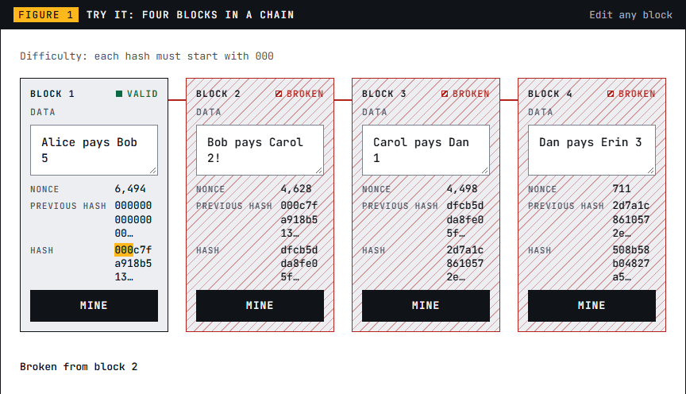

# blockchain-explained

[](https://github.com/TrueScaleTech/blockchain-explained/actions/workflows/ci.yml)
[](LICENSE)

**Live site:** <https://truescaletech.github.io/blockchain-explained/>

How a blockchain works, explained in six short lessons you can operate: hashing, blocks and the chain, mining, Merkle trees, digital signatures, and consensus with the 51% attack. Each lesson pairs a few minutes of theory with a widget that computes real values in your browser. The site is static and bilingual (English and Italian).



> Independent educational project. It is not affiliated with or endorsed by any blockchain project, foundation or company. It shows no prices and gives no financial advice.

## Status

First version: six lessons in English and Italian, each with its widget, tests for every number a widget shows, and CI on Linux and Windows. The lesson texts are a neutral first draft written with AI assistance; see [AI assistance](#ai-assistance).

## What you can do

| Lesson                | Widget                                                                                 |
| --------------------- | -------------------------------------------------------------------------------------- |
| 01 Hashing            | Type anything and watch the SHA-256 hash change; count the bits that flip.             |
| 02 Blocks and chain   | Edit a block in a chain of four and see it, and every block after it, break; re-mine.  |
| 03 Mining             | Pick a difficulty, mine, and compare your runs with the expected 16ⁿ attempts.         |
| 04 Merkle trees       | Edit, add or remove transactions and see the proof that one of them is in the block.   |
| 05 Digital signatures | Sign a message with a throwaway key, change one character, watch verification fail.    |
| 06 Consensus          | Move the attacker's share and the confirmations, read the probability of a 51% attack. |

## Why you can trust the numbers

Every value a widget shows comes from a small function in `src/lib/` with no DOM, and the tests check those functions against published reference values:

- SHA-256 against the NIST examples (FIPS 180-2 appendix B);
- the Merkle root of Bitcoin block 100,000, rebuilt from its four transaction ids;
- an ECDSA P-256 signature from RFC 6979, appendix A.2.5;
- the attacker-success tables and the confirmations table in section 11 of the Bitcoin whitepaper.

A test that has never failed proves nothing, so the logic modules were also broken on purpose in twelve small ways: the suite failed for the ten changes that alter a result; the other two change no output.

The toy chain simplifies the real one, and each lesson says where: the difficulty counts leading hex zeros instead of using Bitcoin's compact target, and the signature demo uses the P-256 curve that browsers offer instead of secp256k1.

## Privacy

No cookies, no analytics, no third-party scripts, fonts, images or APIs. The fonts are self-hosted. A Content-Security-Policy in every page allows only the site's own files (`script-src 'self'`, no inline scripts), and the CI fails if a built page loads anything from another host or contains an inline script. The only things stored in the browser are the theme you pick and the last lesson you opened (local storage, never sent anywhere). The keys of the signature demo are created in memory, cannot be exported and disappear with the page.

## Quick start

You need Node.js 22 or newer.

```bash
npm install
npm run dev
```

The site opens at `http://localhost:4321/blockchain-explained/`.

## Commands

| Command          | What it does                                |
| ---------------- | ------------------------------------------- |
| `npm run dev`    | Local site with live reload                 |
| `npm run build`  | Builds the static site into `dist/`         |
| `npm run check`  | Type check and lesson schema                |
| `npm test`       | Unit tests (no network, no browser)         |
| `npm run links`  | Checks that every cited source still exists |
| `npm run format` | Formats the code and the lessons            |

## How it is built

- [Astro](https://astro.build/) with MDX. One file per lesson and per language in `src/content/lessons/<en|it>/NN-slug.mdx`, with a frontmatter schema checked at build time (title, summary, key points, widget, sources). A test checks that the two languages have the same lessons, widgets and sources.
- Widgets in `src/components/widgets/`: each renders its starting state at build time, so without JavaScript the page still shows a correct static figure; the controls appear only when the script runs.
- Pure logic in `src/lib/` (hashing, blocks, proof of work, Merkle trees and layout, signatures, the whitepaper's attack formula, chart geometry), tested with Node's built-in test runner.
- Colours are tokens in `src/styles/global.css`; a test checks WCAG contrast for the light and dark themes.

## Publishing

GitHub Pages, with the source set to GitHub Actions. Publishing is a manual step: the `Deploy to GitHub Pages` workflow runs only when started by hand (`gh workflow run pages.yml`), so a push to `main` does not change the live site.

## Development

```bash
npm run format:check && npm run check && npm test && npm run build
```

These are the steps the CI runs on Linux and Windows with Node 22 and 24. A weekly job checks the cited sources. See [CONTRIBUTING.md](CONTRIBUTING.md).

## Scope and limits

An explanation of the mechanism, not a guide to any coin, wallet or investment. If something in a lesson is wrong or outdated, [open an issue](https://github.com/TrueScaleTech/blockchain-explained/issues/new/choose) with a primary source.

## AI assistance

This project was built with the help of an AI assistant, including the first draft of the lesson texts. Every number in the widgets is checked by tests against published reference values.

## License

[MIT](LICENSE). The cited papers, standards and documentation belong to their authors.
